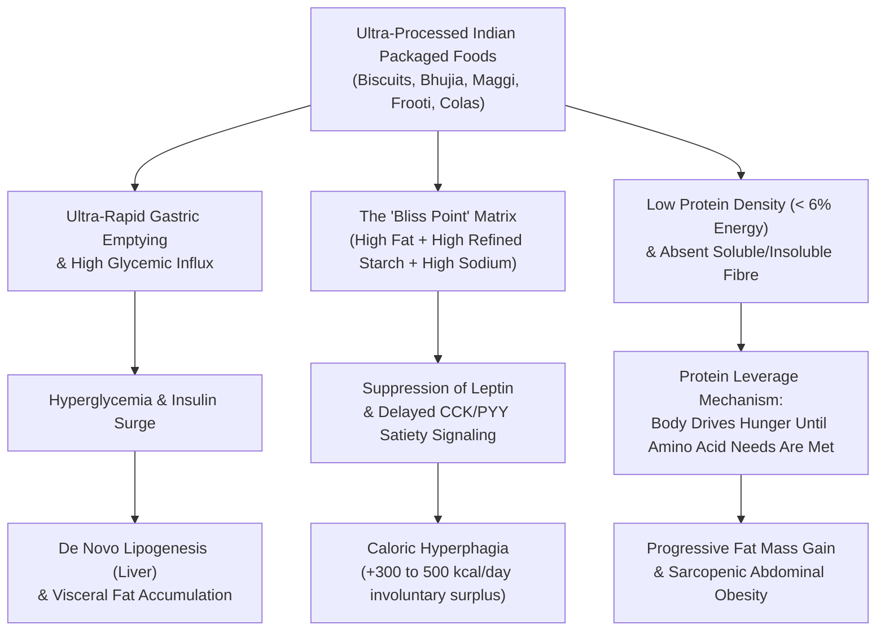

# Indian Packaged Foods: Metabolic Impact, Weight Dynamics, and Nutritional Scoring Formulations

**Author:** FoodLens AI Scientific & Domain Research  
**Reference Standards:** ICMR-NIN (Dietary Guidelines for Indians 2024), FSSAI (Labelling & Display Regulations 2020), WHO Global Action Plan for NCDs, NOVA Food Classification System, Hall et al. (Cell Metabolism).

---

## 1. Executive Summary & The Indian Nutritional Transition

Over the last two decades, India has experienced a dramatic epidemiological shift from traditional, whole-food-centric diets (rich in coarse cereals, pulses, fresh greens, and seasonal vegetables) toward **Ultra-Processed Foods (UPFs)**. According to the **ICMR-NIN 2024 Dietary Guidelines for Indians**, non-communicable lifestyle disorders—including abdominal obesity, Type 2 Diabetes, hypertension, and non-alcoholic fatty liver disease (NAFLD)—now account for over 65% of all adult mortality in India.

### The "Thin-Fat" Indian Phenotype
South Asians possess a unique metabolic vulnerability known as the **"Thin-Fat" Phenotype** (Yajnik-Chittaranjan phenotype). Indians tend to have:
1. **Higher Body Fat Percentage** and higher **Visceral Adiposity** at lower Body Mass Indexes (BMIs) compared to Western cohorts.
2. **Lower Skeletal Muscle Mass** (sarcopenia) and lower metabolic clearance of glucose.
3. **Elevated Baseline Insulin Resistance**, causing modest sugar spikes to drive significant lipid accumulation in the liver and visceral organs.

When ultra-processed Indian snacks, sugary beverages, and refined convenience foods enter this biologically sensitive population, the metabolic consequences are accelerated.

---

## 2. In-Depth Category Analysis of Indian Packaged Goods

### Category A: Biscuits, Cookies & Bakery Products
*Examples: Parle-G, Britannia Good Day, Marie Gold, Sunfeast Dark Fantasy, Cream Biscuits.*

* **Typical Formulation (Per 100g):**
  * **Refined Wheat Flour (Maida):** 60–70%
  * **Total Sugars / Invert Syrup:** 22–32g
  * **Refined Palm / Vegetable Fat:** 12–22g
  * **Sodium (via Sodium Bicarbonate / Leavening):** 200–450 mg
  * **Dietary Fibre:** $< 2.0g$
  * **Energy:** 450–510 kcal

* **Metabolic Consequences:**
  * **Maida + Sugar Rapid Hydrolysis:** The starch in baked maida has an extremely high gelatinization index, breaking down into maltose and glucose in the duodenum within 15–20 minutes.
  * **Hidden Sodium in Sweet Food:** A 100g packet of classic biscuits contains as much sodium as a plate of salty dal (up to 400 mg) due to baking soda ($NaHCO_3$) and ammonium bicarbonate ($NH_4HCO_3$), contributing to elevated arterial stiffness.
  * **Weight Impact:** Very low satiety index ($< 1.2$ vs. boiled potatoes at $3.2$). A single standard tea-time serving (5–6 biscuits) delivers 250 kcal and 15g of simple sugar with zero protein satiety, leading to cravings within 90 minutes.

---

### Category B: Instant Noodles & Ready-to-Cook Pasta
*Examples: Nestlé Maggi 2-Minute Noodles, Sunfeast Yippee, Knorr Soupy Noodles, Top Ramen.*

* **Typical Formulation (Per 100g / Standard Single Pack ~70–80g):**
  * **Flash-Fried Maida Cake:** 80% (deep-fried in refined palmolein oil at 140–160°C).
  * **Sodium:** 900–1,250 mg per packet (representing **45% to 62% of the total daily ICMR-NIN safe limit** in a 75g snack!).
  * **Total Fat:** 13–17g (predominantly palmitic saturated fat).
  * **Flavour Enhancers:** Monosodium Glutamate (INS 621), Disodium Inosinate (INS 631), Disodium Guanylate (INS 627), and Hydrolysed Groundnut Protein.

* **Metabolic Consequences:**
  * **Acute Endothelial Impairment:** Ingesting 1,000+ mg of sodium in 10 minutes leads to transient endothelial dysfunction, vascular wall stiffness, and acute fluid retention (1.0–1.5 kg of transient extracellular water weight).
  * **Palatability Hijack:** The combination of nucleotide flavor enhancers (INS 627/631) with MSG activates the umami T1R1/T1R3 receptor heterodimers in the tongue, creating persistent hedonic cravings.
  * **Weight Impact:** Despite feeling filling due to hot water volume, gastric transit is complete in under 2 hours, resulting in reactive rebound hypoglycemia and evening overeating.

---

### Category C: Traditional Namkeen, Fried Savories & Extruded Snacks
*Examples: Haldiram's Aloo Bhujia, Bikaji Sev, Kurkure Masala Munch, Lay's India's Magic Masala.*

* **Typical Formulation (Per 100g):**
  * **Energy Density:** **560–620 kcal/100g** (more calorically dense than pure milk chocolate).
  * **Refined Cooking Oil (Palmolein / Cottonseed):** 35–44g.
  * **Carbohydrates (Besan / Potato Flakes / Rice Meal):** 45–55g.
  * **Sodium:** 700–1,100 mg.
  * **Fibre:** Variable (1.5–3.5g).

* **Metabolic Consequences:**
  * **The Hyper-Palatable "Fat + Salt" Synergy:** Food science defines the "bliss point" as 35% fat + 50% carb + 1.5% salt. This exact ratio triggers striatal dopamine release without triggering normal stretch receptors in the gastric fundus.
  * **High Thermic Inefficiency:** Ultra-processed fried snacks require almost negligible digestive thermogenesis ($< 3\%$ of calories expended to digest, compared to $20–30\%$ for lean protein or $10–15\%$ for complex whole legumes).
  * **Weight Impact:** Extreme driver of caloric surplus. A modest 150g bag of Bhujia consumed while watching television provides **~900 kcal**—nearly half an adult's entire daily caloric requirement—with negligible nutritional micronutrients.

---

### Category D: Commercial Beverages & Packaged "Fruit" Drinks
*Examples: Frooti, Maaza, Slice, Sting Energy Drink, Carbonated Soft Drinks, Packaged Juices.*

* **Typical Formulation (Per 100ml / 250ml Tetra/PET Pack):**
  * **Actual Fruit Pulp:** Only 10% to 19.5% (the remaining 80%+ is water and added sugar).
  * **Total Sugars:** 13.5–16.5g per 100ml (**33g to 41g per 250ml single bottle**, equivalent to 8 to 10 teaspoons of pure sugar).
  * **Dietary Fibre:** 0.0g to 0.1g (pulp filtration removes all beneficial pectin).
  * **Acidulants:** Citric Acid (INS 330), Tartaric Acid (INS 334).

* **Metabolic Consequences:**
  * **Absence of Satiety Feedback:** Liquid calories do not stimulate salivary amylase, chewing reflexes, or gastric distension. Circulating ghrelin (the hunger hormone) remains completely unsuppressed after drinking 40g of liquid sugar.
  * **Liver Overload (De Novo Lipogenesis):** Industrial high-fructose syrups and sucrose yield 50% free fructose. Unlike glucose (which is utilized by all cells), fructose is metabolized almost exclusively by fructokinase in hepatocytes, driving rapid triglyceride synthesis, hepatic steatosis (fatty liver), and elevated serum uric acid.
  * **Weight Impact:** The strongest statistical lifestyle correlate of childhood and adolescent obesity in urban India.

---

### Category E: Packaged Dairy & Sweetened Milk Derivatives
*Examples: Amul Butter, Processed Cheese Slices, Flavored Milks (Amul Kool, Cavin's), Sweetened Dahi/Mishti Doi.*

* **Nutritional Breakdown:**
  * **Amul Pasteurized Butter:** 80% milk fat, 16% moisture, 2.5% salt ($\approx 840\text{ mg sodium/100g}$). Energy: 722 kcal/100g. Pure lipid density with zero carbs/protein.
  * **Flavored Milk / Sweetened Lassi:** 10–14g sugar per 100ml (a 200ml bottle delivers ~25g sugar).
  * **Processed Cheese Slices:** Up to **1,400 mg sodium per 100g** due to sodium phosphate emulsifying salts (INS 339, INS 452).

* **Metabolic Consequences:**
  * Pure dairy (curd, paneer, unsweetened milk) has high satiety, beneficial conjugated linoleic acid (CLA), and bioactive peptides.
  * However, **commercial packaged dairy products in India frequently use sugar as a preservation and palatability agent**, converting a nutritious protein source into a high-glycemic confection.

---

### Category F: "Health Drinks", Malt Foods & Breakfast Cereals
*Examples: Bournvita, Horlicks, Complan, Kellogg's Chocos, Instant Flavored Oats.*

* **Typical Formulation (Per 100g):**
  * **Added Sugars + Maltodextrin + Liquid Glucose:** 40% to 55% of total dry powder weight.
  * **Refined Cereal Flours:** 20% to 35%.
  * **Protein:** 7–12g (predominantly low-PDCAAS cereal gluten or malt protein).

* **Metabolic Consequences:**
  * **The "Healthy Halo" Illusion:** Marketed to Indian parents as necessary for "bone strength and height growth", two heaped tablespoons (20g) in milk add 10–12g of simple sugar before the school day begins.
  * **Morning Glycemic Crash:** Induces early-morning insulin spiking, followed by reactive hypoglycemia around 10:30–11:00 AM, causing lethargy, reduced cognitive focus, and intense cravings for canteen snacks.

---

## 3. Core Problem Formulations & Mathematical Models

To enable FoodLens AI to calculate, grade, and explain these metabolic phenomena deterministically, we establish four validated mathematical formulas.

---

### 1. Protein Density Score ($PDS$) & Protein-to-Energy ($P:E$) Ratio

#### Theoretical Framework: The Protein Leverage Hypothesis
Biological research (Simpson & Raubenheimer, Oxford) demonstrates that humans regulate protein intake more tightly than carbohydrates or fats. When dietary protein density drops below 10–12% of total calories, individuals passively overconsume energy from fats and carbs until their essential amino acid requirements are met.

#### Formulas:

$$\text{Protein Energy Ratio } (PE\%) = \left( \frac{\text{Protein (g)} \times 4.0\text{ kcal/g}}{\text{Total Energy (kcal)}} \right) \times 100$$

$$\text{Protein Density per 100 kcal } (P_{100}) = \left( \frac{\text{Protein (g)}}{\text{Total Energy (kcal)}} \right) \times 100$$

#### Scoring Scale (0 to 100):

$$PDS = \min\left(100, \, \max\left(0, \, \frac{PE\% - 5.0}{20.0 - 5.0} \times 100\right)\right)$$

| Protein Energy % ($PE\%$) | Classification | Satiety Impact | Typical Indian Food Examples |
| :--- | :--- | :--- | :--- |
| **$< 6.0\%$** | *Critically Diluted* | Drives hyperphagia / continuous eating | Biscuits (Parle-G 5.7%), Frooti (0.6%), Aloo Bhujia (5.5%) |
| **$6.0\% - 10.0\%$** | *Sub-Optimal* | Minimal satiety; requires high total calories | Maggi Noodles (7.5%), Kurkure (4.4%), Sweetened Dahi |
| **$10.0\% - 18.0\%$** | *Moderate / Balanced* | Moderate satiety | Whole Wheat Roti, Plain Cow Milk, Moong Dal Khichdi |
| **$\ge 18.0\%$** | *High Protein Density* | Powerful satiety; optimal for fat loss | Soya Chunks (54%), Boiled Paneer (22%), Roasted Chana (20%), Sprouted Moong |

---

### 2. Estimated Sugar Spike Index ($SSI$) & Glycemic Buffer Ratio ($GBR$)

#### Theoretical Framework: Glycemic Attenuation by Food Matrix
Simple sugars consume rapidly and drive acute glucose spikes. However, the presence of **soluble/insoluble dietary fibre**, **protein**, and **viscous lipids** delays gastric emptying rate and inhibits $\alpha$-amylase / $\alpha$-glucosidase enzymatic activity, dampening the postprandial glucose spike.

#### Formulation:

$$\text{Available Carbohydrates } (CHO_{\text{avail}}) = \max(0, \, \text{Total Carbohydrates (g)} - \text{Dietary Fibre (g)})$$

$$\text{Glycemic Buffering Factor } (GBF) = 1.0 + (0.08 \times \text{Fibre (g)}) + (0.04 \times \text{Protein (g)}) + (0.02 \times \text{Fat (g)})$$

$$\text{Sugar Spike Index } (SSI) = \left( \frac{\text{Sugars (g)} \times 1.5 + (\text{CHO}_{\text{avail}} - \text{Sugars (g)}) \times 0.6}{GBF} \right) \times \left( \frac{100}{\text{Serving Size (g)}} \right)$$

*Where normal serving ranges from 30g to 250ml.*

#### Risk Banding:

$$SSI < 15 \implies \text{LOW GLYCEMIC IMPACT (Gentle release)}$$
$$15 \le SSI < 30 \implies \text{MODERATE GLYCEMIC IMPACT}$$
$$30 \le SSI < 50 \implies \text{HIGH SPIKE RISK (Rapid insulin surge)}$$
$$SSI \ge 50 \implies \text{SEVERE GLYCEMIC SPIKE (Reactive hypoglycemia risk)}$$

*Frooti / Sting score $SSI \approx 62$ (Severe). Parle-G scores $SSI \approx 38$ (High). Roasted Chana scores $SSI \approx 8$ (Low).*

---

### 3. Sodium Density & Cardiovascular Risk Ratio ($SRR$)

#### Theoretical Framework: FSSAI HFSS & ICMR-NIN Tolerable Limits
The ICMR-NIN defines **2,000 mg of sodium** (approx. 5.0 grams of table salt) as the maximum daily upper limit for an adult Indian. Foods with high sodium density disrupt thirst-hunger neurochemistry, cause arterial volume expansion, and accelerate blood pressure elevation.

#### Formulas:

$$\text{Sodium Density per 100 kcal } (SD_{100}) = \left( \frac{\text{Sodium (mg)}}{\text{Total Energy (kcal)}} \right) \times 100$$

$$\text{Percentage of Daily Safe Limit per Serving } (\%RDA_{\text{Na}}) = \left( \frac{\text{Sodium per Serving (mg)}}{2000\text{ mg}} \right) \times 100$$

#### FSSAI HFSS Sodium Thresholds:
* **Solid Foods:** High if Sodium $> 600\text{ mg per 100g}$ (or $> 2.0\text{ mg/kcal}$).
* **Liquid Foods / Beverages:** High if Sodium $> 50\text{ mg per 100ml}$.

#### Sodium Risk Rating ($SRR$):
$$SRR = \min\left(100, \, \frac{\text{Sodium (mg/100g)}}{1200} \times 100\right)$$

*Maggi Tastemaker + Cake: $1,020\text{ mg/100g} \implies SRR = 85/100$ (Critical).*  
*Haldiram's Aloo Bhujia: $840\text{ mg/100g} \implies SRR = 70/100$ (High).*

---

### 4. Satiety & Weight Management Index ($WMI$)

#### Theoretical Framework: Energy Density vs. Nutrient Satiety
For body weight management:
* **Weight Loss Drivers:** High Protein Density, High Dietary Fibre, Low Energy Density ($< 1.8\text{ kcal/g}$), Low Free Sugars.
* **Weight Gain / Overeating Drivers:** High Caloric Density ($> 4.0\text{ kcal/g}$), Hyper-palatable Fat+Sugar combo, Low Protein, High Sodium.

#### The Unified Formula:

$$WMI = 50 + (2.5 \times \text{Protein (g/100g)}) + (3.0 \times \text{Fibre (g/100g)}) - (1.2 \times \text{Sugars (g/100g)}) - (0.8 \times \text{Sat Fat (g/100g)}) - (0.015 \times \text{Sodium (mg/100g)}) - (5.0 \times \text{Energy Density (kcal/g)})$$

#### WMI Interpretation:
* **$WMI \ge 65$ [Optimal for Weight Loss & Lean Retention]:** High fullness per calorie; difficult to overconsume.
* **$40 \le WMI < 65$ [Neutral / Maintenance]:** Moderate caloric control; acceptable in controlled portions.
* **$WMI < 40$ [Weight Gain & Hyperphagia Driver]:** Extremely low satiety, dense empty calories, promotes continuous snacking.

---

## 4. Benchmark Indian FMCG Nutritional Profile Comparison

| Product Name | Category | Energy (kcal/100g) | Sugar (g/100g) | Sodium (mg/100g) | Protein Energy % ($PE\%$) | Sugar Spike Index ($SSI$) | Weight Management Index ($WMI$) |
| :--- | :--- | :--- | :--- | :--- | :--- | :--- | :--- |
| **Parle-G Biscuits** | Biscuits | 454 | 26.5 | 280 | **5.7%** (Low) | **38.2** (High) | **26.8** (Overeating Risk) |
| **Maggi 2-Min Noodles** | Noodles | 427 | 2.2 | **1,020** (Critical) | **7.5%** (Sub-optimal) | **21.4** (Moderate) | **22.5** (Overeating Risk) |
| **Haldiram's Aloo Bhujia** | Namkeen | **579** (Extreme) | 2.4 | **840** (High) | **6.6%** (Low) | **14.2** (Low-Mod) | **14.1** (Severe Weight Gain Driver) |
| **Frooti Mango Drink** | Beverage | 65 | **15.5** (High) | 18 | **0.6%** (None) | **64.0** (Severe Spike) | **18.4** (Visceral Fat Driver) |
| **Amul Butter** | Spreads | **722** (Extreme) | 0.0 | **840** (High) | **0.5%** (None) | **0.0** (None) | **12.0** (Caloric Bomb) |
| **Amul Taaza Milk** | Fresh Dairy | 58 | 4.8 (lactose) | 50 | **22.1%** (Optimal) | **8.5** (Low) | **68.2** (Satiating / Healthy) |
| **Roasted Bengal Gram (Chana)** | Traditional Snack | 380 | 1.2 | 45 | **23.2%** (Optimal) | **6.1** (Very Low) | **82.4** (Superfood for Fat Loss) |

---

## 5. Algorithmic Roadmap for FoodLens AI

By implementing these formulas into the FoodLens AI engine, the application will provide unprecedented nutritional transparency:

1. **Protein Density Badge:** Show users not just raw protein grams, but whether the protein is diluted ($PE\% < 10\%$) or dense ($PE\% \ge 18\%$).
2. **Sugar Spike Gauge (Real-Time SSI):** Visual meter displaying the expected postprandial glucose spike based on the ratio of sugar to fibre/protein buffering.
3. **Sodium Shock Bar:** Displaying the single-serving sodium percentage against the 2,000 mg ICMR-NIN safe daily ceiling.
4. **Weight Management Verdict:** A clear, scientific assessment:
   * *"Calorie Dense / Low Satiety: Likely to drive cravings within 2 hours."*
   * *"High Satiety / Balanced: Supports steady energy and appetite control."*
